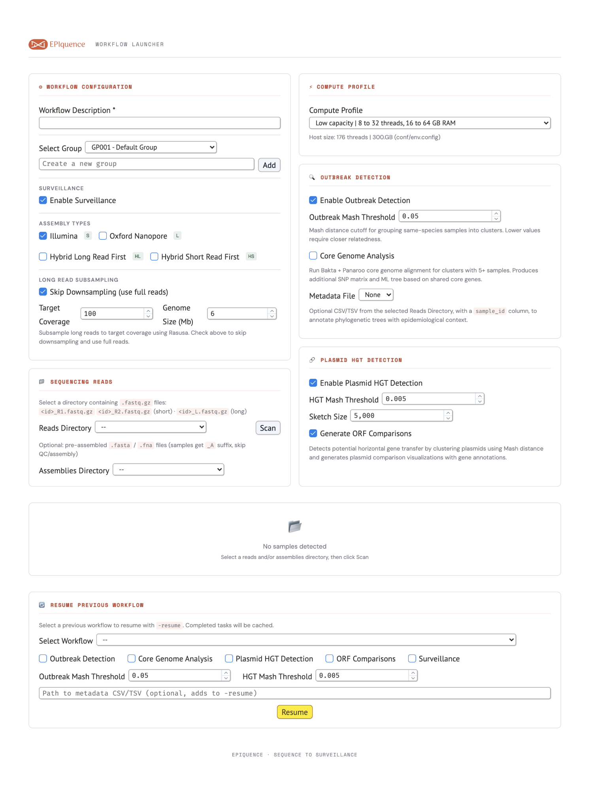
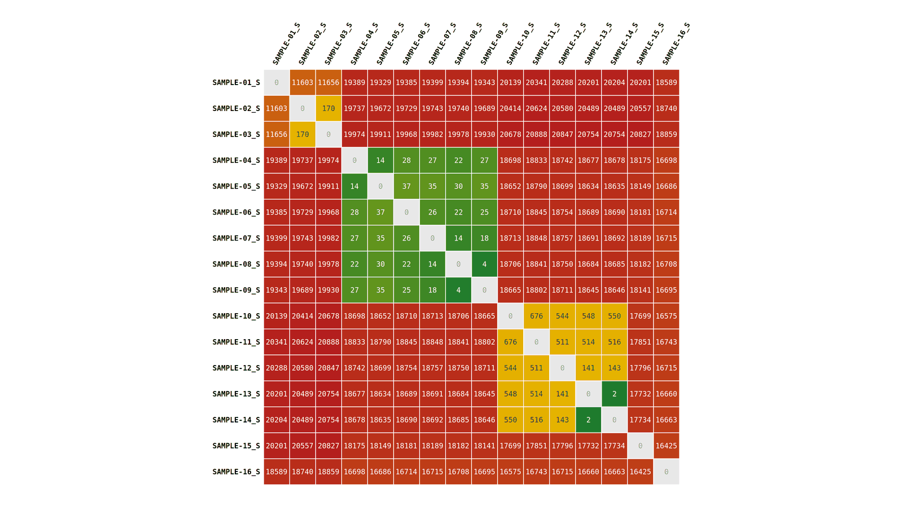
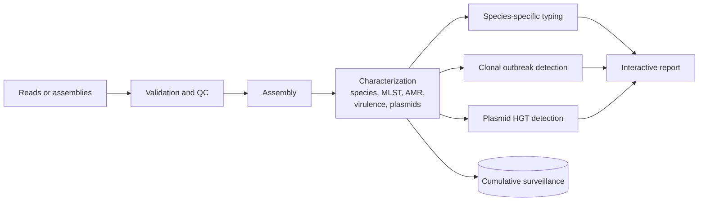

<p align="center">
  
</p>

<p align="center">
  <b>Bacterial genomics from raw reads to cumulative genomic surveillance</b>
</p>

---

**EPIquence** is an end-to-end containerised Nextflow workflow for bacterial genomic surveillance. It enables large scale analysis of bacterial isolates from Illumina, Oxford Nanopore, or hybrid sequencing technologies(or pre-existing assemblies), and obtain results for quality control, assembly, species identification, typing, **antimicrobial resistance (AMR) detection**, **clonal outbreak detection** at SNP level resolution, and **plasmid-mediated horizontal gene transfer (HGT) detection** accompanied by interactive visualisations of the horizontal transfer of AMR plasmids between bacterial isolates across species boundaries.

In addition, EPIquence can keep **cumulative genomic surveillance** of each of the bacterial species analysed. This ensures that new isolates are compared with all previous isolates of the same species, and that clusters keep the same name over time. EPIquence produces a single comprehensive and interactive report containing all the results from a run, and also stores them in a SQL database that can be used for developement of custom reports and interactive live dashboards. A easy web-based **GUI launcher** is provided to help users to launch and resume their runs from the browser without the need to use the command line. Also, it is optimised to run on either less resource workstation (reduced sensitivity on species calls) or on a larger resource server by changing the profile used.

## Highlights

- **Flexible input:** Accepts short reads, long reads, hybrid short and long reads, and/or assemblies either individually or in combination.
- **Species identification and typing:** Species identification based on a GTDB genome taxonomy, MLST Typing, species-specific serotyping and other typing methods for E. coli, Klebsiella spp., Salmonella spp., S. pneumoniae, S. pyogenes, N. meningitidis, and L. pneumophila.
- **AMR and virulence gene detection:** AMR detection of both acquired genes and point mutations and places preedicted genes on either chromosome or plamsid location.
- **Plasmid characterization:** Plasmids are reconstructed from the assembly files and typed for replicon and mobility.
- **Clonal outbreak detection:** Includes species-aware clustering, pairwise SNP matrices, maximum likelihood phylogenies, minimum spanning trees and clustered heatmaps and optional and metadata integration onto trees.
- **Plasmid HGT detection and visualization:** It includes comparison of plasmids from all isolates across species boundaries, identification of near-identical plasmids, interactive circular maps to view shared genes including AMR genes.
- **Cumulative genomic surveillance:** Performs clustering at 10, 20, 50, and 100 SNP distances with constant cluster names over time. Builds interactive phylogenetic trees and pairwise distance matrices across all isolates at species level. Stores results in a SQLite by default, with an optional PostgreSQL database for generating custom reports or live dashboards.
- **One interactive report per run:** Builds a single interactive report summarising all analyses for each run including QC, assembly, taxonomy, typing, AMR, virulence, plasmid, outbreak, and HGT results.
- **GUI launcher:** A web interface that scans the direcotory of reads, builds a sample sheet, allows sample renaming, invidual modules can be toggled on and off, choose compute profile, launches or resumes workflow runs in the background.

## Workflow launcher

<p align="center">
  
</p>

## Report visualizations
#### Clustered Distance Matrix, Likely Transmission Tree, Plasmid Comparision Map

<p align="center">
  
</p>

## How it works



## Requirements

| | `-profile low_capacity` | `-profile high_capacity` |
|---|---|---|
| Host | 8 to 32 threads, 16 to 64 GB RAM | 64+ threads, 256+ GB RAM |
| Species identification | fast, low-memory (about 6 GB) | full phylogenetic placement (about 110 GB per task) |
| Reference databases | about 60 GB | about 300 GB |

Software: Linux x86-64, Java 17+, **Nextflow 25.10.2**, **Apptainer or SingularityCE**, Conda (Miniforge recommended) and Python 3.9+

## Installation

**Debian / Ubuntu**

```bash
sudo apt-get update
sudo apt-get install -y openjdk-17-jre-headless python3 procps tzdata curl git
# Apptainer:
# On Ubuntu use the PPA below. On Debian, install the .deb from https://github.com/apptainer/apptainer/releases
sudo add-apt-repository -y ppa:apptainer/ppa
sudo apt-get update && sudo apt-get install -y apptainer
# SingularityCE:
# Based on your Linux distribution, download the .deb from https://github.com/sylabs/singularity/releases, then
sudo apt-get install -y ./singularity-ce-4.6.0.deb
```

**RHEL / Rocky Linux / AlmaLinux**

```bash
sudo dnf install -y java-17-openjdk-headless python3 procps-ng tzdata curl git
# Apptainer:
sudo dnf install -y epel-release
sudo dnf install -y apptainer
# SingularityCE:
# Based on your Linux distribution, download the .rpm from https://github.com/sylabs/singularity/releases, then
sudo dnf install -y ./singularity-ce-4.6.0.rpm
```

**Both** (Nextflow, Conda, folders and the pipeline):

```bash
export NXF_VER=25.10.2 && curl -s https://get.nextflow.io | bash && sudo mv nextflow /usr/local/bin/
curl -L -O https://github.com/conda-forge/miniforge/releases/latest/download/Miniforge3-Linux-x86_64.sh
bash Miniforge3-Linux-x86_64.sh -b -p /opt/miniforge3 && /opt/miniforge3/bin/conda init bash
sudo mkdir -p /data/epiquence /data/apps/singularity/{cache,layers} /data/apps/conda/envs /data/tmp
cd /data/epiquence
git clone https://github.com/slalam/epiquence.git pipeline
cd pipeline && chmod +x bin/*.py
```


```bash
# Apptainer:
export APPTAINER_CACHEDIR=/data/apps/singularity/layers APPTAINER_TMPDIR=/data/tmp
# SingularityCE:
export SINGULARITY_CACHEDIR=/data/apps/singularity/layers SINGULARITY_TMPDIR=/data/tmp
```

Nextflow keeps the images it runs in `singularity.cacheDir` (set in `conf/env.config`, see Configuration). Optionally, pull all images once before the first run. The script uses Apptainer if it is installed, otherwise SingularityCE.

```bash
# Low capacity:
scripts/prefetch_containers.sh --profile low_capacity
# High capacity:
scripts/prefetch_containers.sh --profile high_capacity
```


## Database setup

Which databases you need depends on the compute profile. Run the downloads inside the pipeline's own containers so the versions match. Commands are shown for both Apptainer and SingularityCE.

```bash
mkdir -p /data/databases/{busco,gtdb,bakta,sylph,epiquence}

# BUSCO lineage (always)
# Apptainer:
apptainer exec -B /data/databases docker://staphb/busco:6.0.0 \
  busco --download bacteria_odb12 --download_path /data/databases/busco
# SingularityCE:
singularity exec -B /data/databases docker://staphb/busco:6.0.0 \
  busco --download bacteria_odb12 --download_path /data/databases/busco
```

**Low capacity** (sylph, with Bakta light already included in its container):

```bash
cd /data/databases/sylph
wget http://faust.compbio.cs.cmu.edu/sylph-stuff/gtdb-r226-c1000-dbv1.syldb
# Optional: c200 database (18.4 GB on disk, needs about 24 GB RAM), then point sylph_db at it
# wget http://faust.compbio.cs.cmu.edu/sylph-stuff/gtdb-r226-c200-dbv1.syldb
wget https://data.gtdb.ecogenomic.org/releases/release226/226.0/bac120_taxonomy_r226.tsv.gz
wget https://data.gtdb.ecogenomic.org/releases/release226/226.0/ar53_taxonomy_r226.tsv.gz
```

**High capacity** (GTDB-Tk R226 and the full Bakta database):

```bash
cd /data/databases/gtdb
wget https://data.gtdb.ecogenomic.org/releases/release226/226.0/auxillary_files/gtdbtk_package/full_package/gtdbtk_r226_data.tar.gz
tar -xzf gtdbtk_r226_data.tar.gz && rm gtdbtk_r226_data.tar.gz
# Bakta full database
# Apptainer:
apptainer exec -B /data/databases docker://staphb/bakta:1.11.4 \
  bakta_db download --output /data/databases/bakta/1.11.4 --type full
# SingularityCE:
singularity exec -B /data/databases docker://staphb/bakta:1.11.4 \
  bakta_db download --output /data/databases/bakta/1.11.4 --type full
```

**Results database** (used with `--surveillance`): SQLite works out of the box. For PostgreSQL, create a database owned by the pipeline user. Tables are created automatically.

```sql
CREATE ROLE epiquence LOGIN PASSWORD '*******';
CREATE DATABASE epiquence OWNER epiquence;
```


## Configuration

Host-specific settings live in `conf/env.config`, which is gitignored:

```bash
cp conf/env.config.template conf/env.config
chmod 600 conf/env.config
```

At the least, set these parameters:

```groovy
params {
    max_cpus   = 16                 // all hardware threads
    max_memory = 18.GB              // RAM minus a little headroom
    busco_db   = "/data/databases/busco"
    gtdbtk_db  = "/data/databases/gtdb/release226"                       // high capacity
    bakta_db   = "/data/databases/bakta/1.11.4/db"                       // high capacity
    sylph_db       = "/data/databases/sylph/gtdb-r226-c1000-dbv1.syldb"  // low capacity
    sylph_taxonomy = "/data/databases/sylph/bac120_taxonomy_r226.tsv.gz,/data/databases/sylph/ar53_taxonomy_r226.tsv.gz"
    surveillance_db_url = "sqlite:////data/databases/epiquence/epiquence_db.db"
}
```

Detailed params explained: [Configuration](docs/usage.md#configuration).

## Basic examples

A sample sheet lists one isolate per row. Leave a column empty when that read type is not available:

```csv
sample_id,long_R,short_R1,short_R2
SAMPLE-01,,/data/epiquence/reads/batch1/SAMPLE-01_R1.fastq.gz,/data/epiquence/reads/batch1/SAMPLE-01_R2.fastq.gz
SAMPLE-02,/data/epiquence/reads/batch1/SAMPLE-02_L.fastq.gz,,
SAMPLE-03,/data/epiquence/reads/batch1/SAMPLE-03_L.fastq.gz,/data/epiquence/reads/batch1/SAMPLE-03_R1.fastq.gz,/data/epiquence/reads/batch1/SAMPLE-03_R2.fastq.gz
```

**1. Illumina isolates on a workstation**

```bash
nextflow run /data/epiquence/pipeline/main.nf -profile low_capacity \
    --sample_sheet samples.csv --assembly_type S \
    --outdir results --workflow_id "W$(date +%m%d%y%H%M%S)" --workflow_description "First run"
```

**2. Hybrid assemblies with outbreak and plasmid analysis on a server**

```bash
nextflow run /data/epiquence/pipeline/main.nf -profile high_capacity \
    --sample_sheet samples.csv --assembly_type HL \
    --outbreak --metadata metadata.csv --plasmid_hgt --hgt_maps \
    --outdir results --workflow_id "W$(date +%m%d%y%H%M%S)" --workflow_description "Hybrid batch"
```

**3. Add a run to cumulative surveillance**

```bash
nextflow run /data/epiquence/pipeline/main.nf -profile low_capacity \
    --sample_sheet samples.csv --assembly_type S --surveillance \
    --group_id GP001 --group_description "Healthcare-Associated Infections" \
    --outdir results --workflow_id "W$(date +%m%d%y%H%M%S)" --workflow_description "Week 45"
```

**4. Existing assemblies, or a resume after adding a module**

```bash
nextflow run /data/epiquence/pipeline/main.nf -profile low_capacity \
    --assemblies_dir /data/epiquence/assemblies/batch1 \
    --outdir results --workflow_id W_ASM01 --workflow_description "Imported assemblies"
# Add -resume to same command, id additional options are included or to resume failed runs
nextflow run /data/epiquence/pipeline/main.nf ... --outbreak -resume
```

**5. Web launcher**

The launcher reads its settings from `epiquence_config.json` in the repository folder. Update it for your system before the first start:

```json
{
  "pipeline_dir": ".",
  "output_base": "/data/epiquence/results",
  "reads_base": "/data/epiquence/reads",
  "reads_sort": "modified",
  "reads_sort_desc": true,
  "reads_show_date": true,
  "groups": {
    "GP001": "Default Group"
  },
  "default_profile": "high_capacity"
}
```

| Setting | What to set |
|---|---|
| `output_base` | Folder where each launched workflow gets its own `W<MMDDYYHHMMSS>` folder with results |
| `reads_base` | Folder whose subfolders contain your reads, one subfolder per batch. These appear in the Reads Directory dropdown |
| `default_profile` | `high_capacity` for a server or `low_capacity` for a workstation. This is the profile selected when the launcher opens |
| `pipeline_dir` | Folder containing `main.nf`. `"."` indicates launcher is in same directory as the pipeline |
| `groups` | Group IDs and descriptions. New groups added in the launcher are saved here |

Then install marimo and start the launcher:

```bash
pip install "marimo>=0.20"
marimo run epiquence_launcher.py --host 0.0.0.0 --port 2718
```

Open the address it prints in a browser.

Open `results/multiqc/multiqc_report.html` when a run finishes.

### What you get

| Output | Where |
|---|---|
| Interactive report for the run | `results/multiqc/multiqc_report.html` |
| Assemblies, plasmid and chromosome sequences | `results/<sample>/assemblies/`, `results/summaries/` |
| Combined tables (species, MLST, AMR genes and mutations, virulence, plasmids, typing) | `results/summaries/*.tsv` |
| Outbreak clusters: SNP matrices, trees, heatmaps | `results/outbreak/` |
| Plasmid HGT: clusters, comparison maps, plots | `results/plasmid_hgt/<assembly type>/` |
| Surveillance trees and distance matrices (all isolates and per group) | `surveillance_results_dir` in `conf/env.config` |
| Everything above in SQL, for dashboards | `surveillance_db_url` |

## Documentation

The [detailed usage guide](docs/usage.md) explains how to install, configure, run and maintain EPIquence. It covers requirements and compute profiles, installation, reference databases and configuration. It also describes inputs, running from the command line or the launcher, examples, parameters and outputs, followed by species identification, surveillance, upgrading and troubleshooting.

## Repository layout

```text
epiquence/
├── main.nf                        pipeline entry point
├── nextflow.config                parameters, containers and compute profiles
├── epiquence_launcher.py          web launcher
├── epiquence_config.json          launcher settings
├── conf/
│   └── env.config.template        template for host-specific settings
├── modules/                       Nextflow processes, one file per analysis area
├── subworkflows/                  how the processes are combined
├── bin/                           Python scripts used by the processes
│   ├── epiquence_lib/             shared helper code
│   └── templates/                 HTML templates for the interactive pages
├── scripts/
│   └── prefetch_containers.sh     optional: pull all container images before the first run
├── docs/
│   ├── usage.md                   full usage guide
│   └── images/                    logo, launcher screenshot and example visualizations
├── LICENSE                        MIT License
└── README.md
```

## Tools and libraries

EPIquence is built on these open-source projects, cite them when results are published.

- [Altair](https://github.com/vega/altair)
- [AMRFinderPlus](https://github.com/ncbi/amr)
- [Apptainer](https://github.com/apptainer/apptainer)
- [Bakta](https://github.com/oschwengers/bakta)
- [BLAST+](https://github.com/ncbi/blast_plus_docs)
- [BUSCO](https://gitlab.com/ezlab/busco)
- [BWA-MEM2](https://github.com/bwa-mem2/bwa-mem2)
- [CGView.js](https://github.com/stothard-group/cgview-js)
- [D3](https://github.com/d3/d3)
- [dnaapler](https://github.com/gbouras13/dnaapler)
- [ECTyper](https://github.com/phac-nml/ecoli_serotyping)
- [el_gato](https://github.com/CDCgov/el_gato)
- [emmtyper](https://github.com/MDU-PHL/emmtyper)
- [fastp](https://github.com/OpenGene/fastp)
- [fastplong](https://github.com/OpenGene/fastplong)
- [Flye](https://github.com/mikolmogorov/Flye)
- [GTDB-Tk](https://github.com/Ecogenomics/GTDBTk)
- [IQ-TREE 3](https://github.com/iqtree/iqtree3)
- [Kleborate](https://github.com/klebgenomics/Kleborate)
- [marimo](https://github.com/marimo-team/marimo)
- [Mash](https://github.com/marbl/Mash)
- [Mashtree](https://github.com/lskatz/mashtree)
- [Medaka](https://github.com/nanoporetech/medaka)
- [meningotype](https://github.com/MDU-PHL/meningotype)
- [Metabase](https://github.com/metabase/metabase)
- [minimap2](https://github.com/lh3/minimap2)
- [mlst](https://github.com/tseemann/mlst)
- [MOB-suite](https://github.com/phac-nml/mob-suite)
- [mosdepth](https://github.com/brentp/mosdepth)
- [MultiQC](https://github.com/MultiQC/MultiQC)
- [MUMmer4](https://github.com/mummer4/mummer)
- [NanoPlot](https://github.com/wdecoster/NanoPlot)
- [Nextflow](https://github.com/nextflow-io/nextflow)
- [Ollama](https://github.com/ollama/ollama)
- [Panaroo](https://github.com/gtonkinhill/panaroo)
- [Polypolish](https://github.com/rrwick/Polypolish)
- [QUAST](https://github.com/ablab/quast)
- [Rasusa](https://github.com/mbhall88/rasusa)
- [ReporTree](https://github.com/insapathogenomics/ReporTree)
- [ResFinder / PointFinder](https://github.com/genomicepidemiology/resfinder)
- [SAMtools](https://github.com/samtools/samtools)
- [SeqKit](https://github.com/shenwei356/seqkit)
- [SeroBA](https://github.com/sanger-pathogens/seroba)
- [SISTR](https://github.com/phac-nml/sistr_cmd)
- [SKA2](https://github.com/bacpop/ska.rust)
- [snp-dists](https://github.com/tseemann/snp-dists)
- [SQLAlchemy](https://github.com/sqlalchemy/sqlalchemy)
- [StaPH-B container images](https://github.com/StaPH-B/docker-builds)
- [sylph](https://github.com/bluenote-1577/sylph)
- [toytree](https://github.com/eaton-lab/toytree)
- [UMAP](https://github.com/lmcinnes/umap)
- [Unicycler](https://github.com/rrwick/Unicycler)
- [VirulenceFinder](https://github.com/genomicepidemiology/virulencefinder)

## License

EPIquence is released under the [MIT License](LICENSE).
